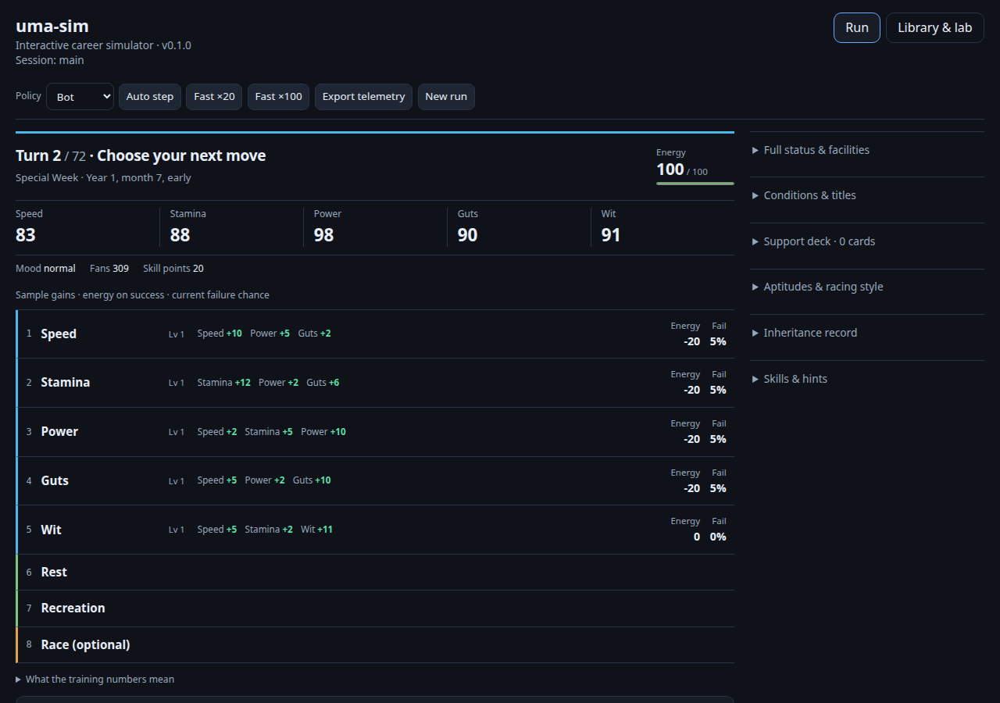

# Uma Sim experimental Linux player preview — November 10, 2026

[Download the runnable ZIP](uma-sim-v0.3.0-preview.20261110-linux-x64-glibc239.zip?raw=true)

This is a versioned experimental repository download, not a replacement for the stable v0.2.2 releases. It contains the actual native CLI, embedded browser UI, runtime catalogs, license and attribution. No Rust or Node installation is needed to play.

## Watch the player

[Watch or download the 29-second walkthrough](media/uma-preview-walkthrough.mp4?raw=true) · [Caption transcript](media/uma-preview-walkthrough.srt)

This silent, captioned recording uses the exact native ZIP below. It follows one real seed-42 career: enter the required debut race, compare all five training choices, read the sample caveat, choose Speed manually, and inspect the retained history. The sample shows Speed +10; the actual history records +11. Samples are not guaranteed gains or expected values. Captions sit below the original browser image.

[Phone training view](media/phone-training.png) · [Required race view](media/desktop-race.png)

## Launch

1. Use x86-64 Linux with **glibc 2.39 or newer**, such as Ubuntu 24.04+.
2. Extract the complete ZIP into a writable folder.
3. Open a terminal in the extracted `uma-sim-linux-x64-glibc239-preview` folder.
4. Run `chmod +x uma-sim`, then `./uma-sim serve --open`.
5. If the browser does not open, visit <http://127.0.0.1:8765/>. Stop the server with Ctrl+C.

Keep `research/`, `knowledge/` and `content_packs/` next to the executable. The server can be launched from a different working directory. The CLI saves its career under `.uma-sim/` in the current working directory.

Run a full career with `./uma-sim fast --seed=42 --policy=bot`. Available scenarios are `ura`, `grand_concert`, `unity` and `trackblazer`. The `fast` command starts a new career and replaces the saved career in that working directory.

## What is better

- Current turn, energy, stats and manual choices appear together. Required race actions and all five training choices are readable on a 390px phone.
- Training choices show native sample gains, successful energy change and current failure chance, with explicit limits on what samples predict.
- Selecting Default during setup now also selects Default for the next automatic step.
- Relative batch outputs are written in the caller's directory and can feed directly into `compare-batches`.
- The embedded browser includes the current branch outcome comparison and required event dialog work.

## Exact source and integrity

Source: [`fda3c78f1673a038bf38e12a581340d06b4a572a`](https://github.com/Jacob-Met/uma-sim/tree/fda3c78f1673a038bf38e12a581340d06b4a572a). The runtime data is copied from that exact Git tree, and the browser UI is built and embedded from the same source.

ZIP: uma-sim-v0.3.0-preview.20261110-linux-x64-glibc239.zip, **3,107,703 bytes**.

SHA-256: `914e942a8142735822ae38cdee9f24acb393dbfb908a1e534fe1bc8e7b67b2ab`.

Verify with `sha256sum -c SHA256SUMS` after downloading both files into one folder. [Download checksum](SHA256SUMS?raw=true).

Built on the Renpō Linux fleet with Rust 1.99.1 and Node 22.23.4. Actual extracted copies were launched from unrelated working directories, including with the source data hidden. Native complete 72-turn careers, direct batch-to-paired comparisons, and actual Chrome desktop/phone journeys were exercised. The merged UI passed 131 tests. The decision UI and CLI correction received separate independent actual-use reviews. No GitHub Actions were used.

## Limits

This preview requires glibc 2.39; it does not retain stable v0.2.2's glibc 2.28 compatibility. It supplies no Windows or macOS binary. The internal engine version shown in the UI remains 0.1.0; the source commit above identifies this preview build.

Unofficial fan simulator, not affiliated with Cygames. Game parity is incomplete, and in-simulator outcomes are not actual game win-rate predictions. This preview makes no claim of a stronger bot policy. See the included LICENSE, NOTICE and [simulator documentation](../docs/SIMULATOR.md).
