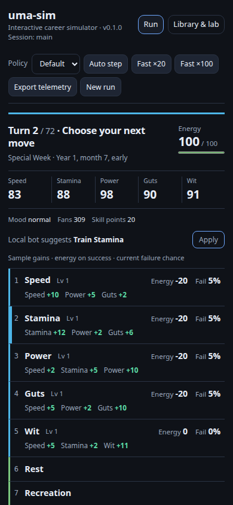

# Uma Sim experimental Linux player preview — v0.3.2

[Download the runnable ZIP](https://github.com/Jacob-Met/uma-sim/releases/download/v0.3.2-preview.20261110/uma-sim-v0.3.2-preview.20261110-linux-x64-glibc239.zip) · [Checksums](https://github.com/Jacob-Met/uma-sim/releases/download/v0.3.2-preview.20261110/SHA256SUMS)

The native CLI and embedded browser player require **Linux x86-64, glibc 2.39+ (Ubuntu 24.04+)**. No Rust or Node installation is needed. Stable v0.2.2 remains available with wider platform support.

## Inspect and apply a local suggestion

The current turn now shows the native local bot's proposed action beside an **Apply** button. Open **Why this local suggestion?** below the manual choices to read its reason and relative training scores. Apply makes exactly one manual choice through the same session-bound action route as the other buttons.

The suggestion is explicitly the built-in local heuristic. **Auto step still uses the policy selected in the toolbar**, which can differ. Scores are relative decision values, not success chances or predicted gains. Manual training samples retain their separate energy, failure and sample-gain explanations.



This image is the actual production UI against the native API, with Default selected for automation. All five training rows and Rest remain visible at 390 × 844. The same UI was then embedded and independently played: Apply entered the mandatory race, suggested Stamina on turn 2, and retained the actual training event on turn 3. Opening the explanation submitted no action.

## Launch

1. Extract the complete ZIP into a writable folder.
2. Open a terminal inside `uma-sim-linux-x64-glibc239-preview`.
3. Run `chmod +x uma-sim`, then `./uma-sim serve --open`.
4. If the browser does not open, visit <http://127.0.0.1:8765/>. Stop with Ctrl+C.
5. Wait for **Ready · career catalogs loaded** before starting a career. The initial embedded review encountered a disabled Start button before readiness; a subsequent ready-state interaction passed. That initial delay remains an observed limitation.

Keep `research/`, `knowledge/` and `content_packs/` beside the executable. CLI careers save to `.uma-sim/` in the caller's working directory. `./uma-sim fast --seed=42 --policy=bot` starts a fresh full career and replaces that directory's saved career.

## Source and checks

Source: [`e42d09e59062feaa20a549dbf5ec68cfef908faf`](https://github.com/Jacob-Met/uma-sim/tree/e42d09e59062feaa20a549dbf5ec68cfef908faf). Runtime catalogs and embedded UI come from this exact tree.

ZIP: `uma-sim-v0.3.2-preview.20261110-linux-x64-glibc239.zip`, **2,885,002 bytes**. SHA-256:

```text
aea09777da97fbfe9923300c2269e7411521c7609ea0997abd0fa2bd43057033
```

Extracted binary SHA-256: `0788d13b30c05f085b135c9f6ab1da4655b69335f81173fda22768e649e6fe64`.

Download SHA256SUMS beside the ZIP and run `sha256sum --ignore-missing -c SHA256SUMS`. Built on the Renpō fleet with Rust 1.99.1; GitHub Actions stayed disabled.

The UI production build and 132 tests passed. The native API passed 14 tests, including unchanged session/RNG on reads, application matching the native local action, completed-career null advice and unchanged stored checkpoint schema. The extracted ZIP passed the maintained release-layout smoke test from an unrelated directory with the source data hidden: both stub and physics careers reached turn 72. Separate fresh visual and interactive reviews accepted phone/desktop readability and the real two-action suggestion workflow, including the embedded native route.

## Policy limits

This update adds player access to advice; it does not change the bot policy. The v0.3.1 stat-target correction's frozen comparison remains the applicable evidence: 384 paired careers, 338 higher terminal scores, 45 lower and one tie, with mean improvement in all eight scenario/context cells. The largest primary URA loss was 1,305 points. Every parsed race in 48 selected full-career replays remained ninth on both policies. Recovery, racing and training balance remain weak. [Protocol and raw evidence](../docs/research/local-bot-stat-targets-20261110/README.md).

This is an unofficial fan simulator, not affiliated with Cygames. Game parity is incomplete; simulated scores are not actual-game win-rate predictions. No Windows/macOS binary is supplied here. The internal engine version still reads 0.1.0; the source commit identifies this build. LICENSE and NOTICE are bundled.

## Earlier previews and walkthrough

[v0.3.1 source, download and checks](PREVIEW-v0.3.1.md) · [v0.3.0 source, download and checks](PREVIEW-v0.3.0.md)

[Silent 29-second manual walkthrough](media/uma-preview-walkthrough.mp4?raw=true) · [Captions](media/uma-preview-walkthrough.srt). This older recording uses v0.3.0 and shows manual training samples/history; it does not show the new suggestion controls. Earlier ZIPs remain unchanged.
