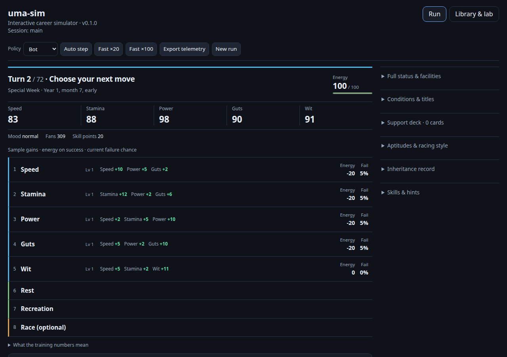

# Uma Sim experimental Linux player preview — November 10, 2026

[Download the runnable ZIP](uma-sim-v0.3.1-preview.20261110-linux-x64-glibc239.zip?raw=true)

This is a versioned experimental repository download, not a replacement for the stable v0.2.2 releases. It contains the actual native CLI, embedded browser UI, runtime catalogs, license and attribution. No Rust or Node installation is needed to play.

## Watch the player

[Watch or download the 29-second walkthrough](media/uma-preview-walkthrough.mp4?raw=true) · [Caption transcript](media/uma-preview-walkthrough.srt)

This silent, captioned recording uses the earlier v0.3.0 preview. The manual decision interface and sample display are unchanged in v0.3.1. It follows one real seed-42 career: enter the required debut race, compare all five training choices, read the sample caveat, choose Speed manually, and inspect the retained history. The sample shows Speed +10; the actual history records +11. Samples are not guaranteed gains or expected values. Captions sit below the original browser image.

[Phone training view](media/phone-training.png) · [Required race view](media/desktop-race.png)

## Launch

1. Use x86-64 Linux with **glibc 2.39 or newer**, such as Ubuntu 24.04+.
2. Extract the complete ZIP into a writable folder.
3. Open a terminal in the extracted `uma-sim-linux-x64-glibc239-preview` folder.
4. Run `chmod +x uma-sim`, then `./uma-sim serve --open`.
5. If the browser does not open, visit <http://127.0.0.1:8765/>. Stop the server with Ctrl+C.

Keep `research/`, `knowledge/` and `content_packs/` next to the executable. The server can be launched from a different working directory. The CLI saves its career under `.uma-sim/` in the current working directory.

Run a full career with `./uma-sim fast --seed=42 --policy=bot`. Available scenarios are `ura`, `grand_concert`, `unity` and `trackblazer`. The `fast` command starts a new career and replaces the saved career in that working directory.

## Local bot correction in v0.3.1

The native local bot now assigns nonzero value to training stat gains, using effective scenario/legacy caps as its default targets. Previously the empty target map made all stat gains contribute zero.

A separate, frozen evaluation covered 384 paired full careers across four scenarios and two trainee/deck contexts: 338 terminal scores improved, 45 regressed and one tied. Mean score improved in every context/scenario cell; the largest observed primary URA loss was **1,305 points**. The empty-deck policy still concentrates heavily on Stamina. **All parsed races in 48 selected full-career replays remained ninth place on both policies.** This is a terminal-score correction, not a claim of stronger racing. [Protocol, raw outcomes, costs and replay logs](../docs/research/local-bot-stat-targets-20261110/README.md).

## Player improvements retained

- Current turn, energy, stats and manual choices appear together. Required race actions and all five training choices are readable on a 390px phone.
- Training choices show native sample gains, successful energy change and current failure chance, with explicit limits on what samples predict.
- Selecting Default during setup now also selects Default for the next automatic step.
- Relative batch outputs are written in the caller's directory and can feed directly into `compare-batches`.
- The embedded browser includes the current branch outcome comparison and required event dialog work.

## Exact source and integrity

Source: [`a035857cffdd3a44799767b9123bfbf80ae9d200`](https://github.com/Jacob-Met/uma-sim/tree/a035857cffdd3a44799767b9123bfbf80ae9d200). The runtime data is copied from that exact Git tree, and the browser UI is built and embedded from the same source.

ZIP: uma-sim-v0.3.1-preview.20261110-linux-x64-glibc239.zip, **2,884,641 bytes**.

SHA-256: `4556c0853b73614789b202a62eb59ab55211ca8f1dc86654ca9187b11bf732b2`.

Verify with `sha256sum --ignore-missing -c SHA256SUMS` after downloading both files into one folder. [Download checksum](SHA256SUMS?raw=true).

Built on the Renpō Linux fleet with Rust 1.99.1 and the unchanged embedded UI from the same source tree. The extracted v0.3.1 package completed all four native 72-turn scenarios with fresh seed 887, produced bot/default batches for seeds 887/991/1069 in the caller's directory, and fed those files into native paired comparison. Actual Chrome phone use exercised setup, the required race, all five training choices and a manual Speed action to turn 3. The merged correction passed the full Rust workspace suite; the retained UI had passed 131 tests. No GitHub Actions were used.

## Limits

This preview requires glibc 2.39; it does not retain stable v0.2.2's glibc 2.28 compatibility. It supplies no Windows or macOS binary. The internal engine version shown in the UI remains 0.1.0; the source commit above identifies this preview build.

Unofficial fan simulator, not affiliated with Cygames. Game parity is incomplete, and in-simulator outcomes are not actual game win-rate predictions. The measured local-policy improvement is limited to the terminal objectives above; recovery and optional-race scheduling remain weak. See the included LICENSE, NOTICE and [simulator documentation](../docs/SIMULATOR.md).

## Previous preview

[v0.3.0 download](uma-sim-v0.3.0-preview.20261110-linux-x64-glibc239.zip?raw=true) · [Original source, checksum and notes](PREVIEW-v0.3.0.md). The earlier artifact is preserved unchanged.
